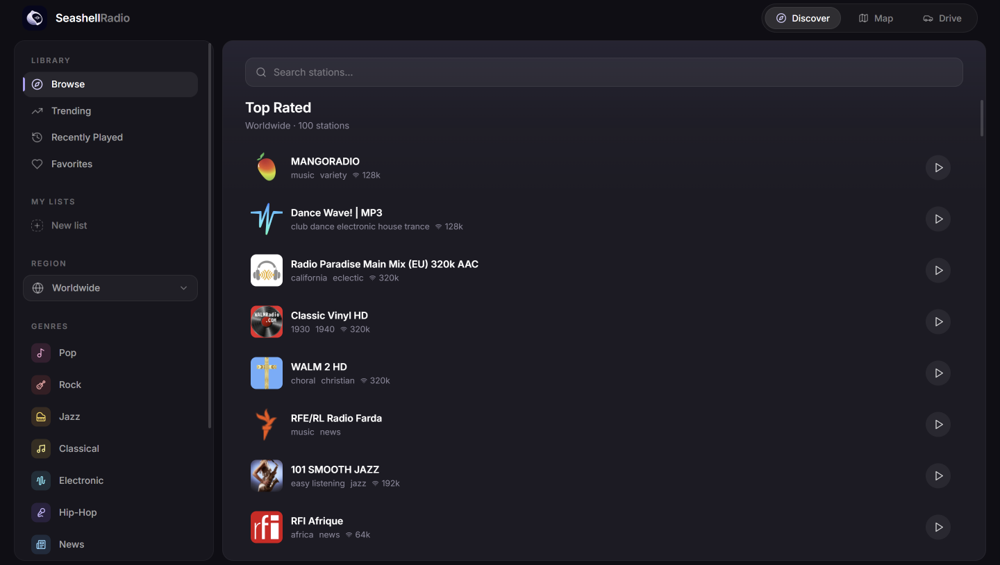
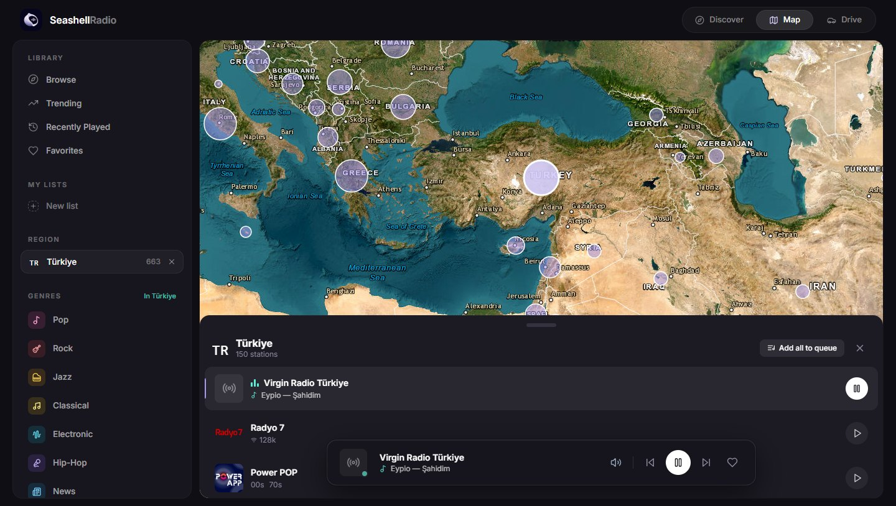
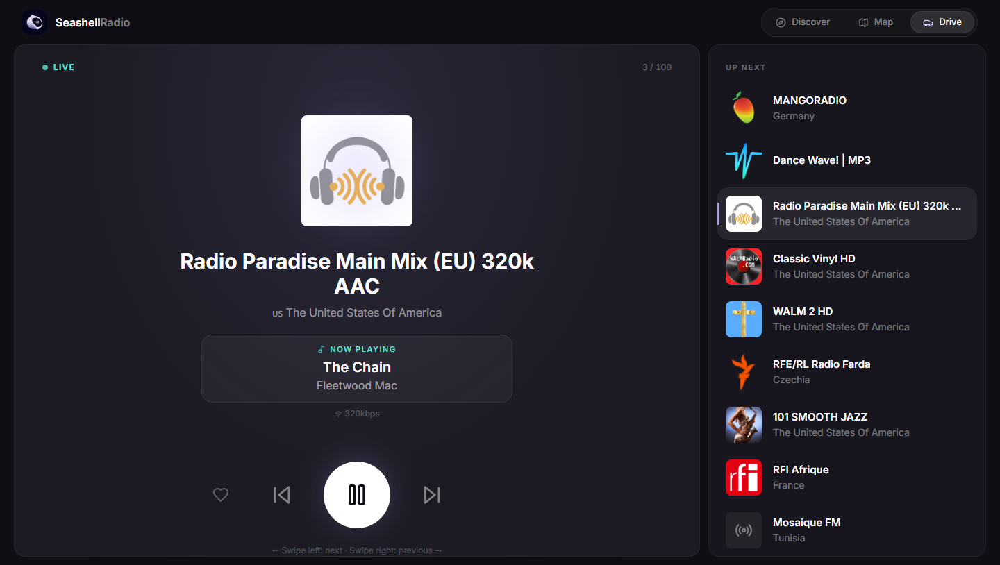
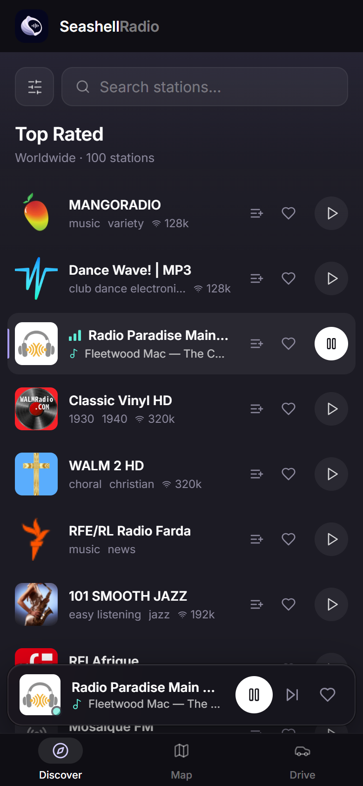

# Seashell Radio

**Discover and listen to live radio stations from around the world — directly in your browser.**

**Live application:** [seashellradio.com](https://seashellradio.com/)



Seashell Radio is an open-source web application for exploring thousands of live radio stations worldwide. Browse what is popular, filter by country and genre, explore stations on a satellite world map, and switch to a large, distraction-reduced player for the car. No account or subscription is required.

## Screenshots

| Map | Drive |
|---|---|
|  |  |

<p align="center">
  
</p>

## Project Goal

Seashell Radio aims to make worldwide live radio immediate, accessible, and enjoyable. It brings together stations from across the globe in a focused interface designed for everyday listening, geographic exploration, and convenient controls on desktop and mobile devices.

The experience is organized around three modes:

- **Discover** — Browse top rated and trending stations, search, and filter by country and genre.
- **Map** — Explore stations geographically on a satellite world map.
- **Drive** — Use large playback controls, swipe navigation, and device media controls.

All modes share one playback engine, so switching between them never interrupts the active stream.

## Key Features

### Discover

- **Library**
  - **Browse** — the community's top rated stations.
  - **Trending** — the most played stations in the last 24 hours.
  - **Recently Played** — your listening history.
  - **Favorites** — stations you have saved.
- **My Lists** — create your own station lists.
- **Region and genre filters that combine**, for example pop stations in Türkiye.
- Search stations by name.

### Map

- Satellite imagery with country borders and place names.
- Country markers sized by the number of stations.
- The same Library and filters sidebar as Discover. Picking a country flies the map to it and opens its stations.
- A resizable station panel inside the map area. A genre picked in the sidebar narrows the country's stations.
- Add every station of a country to the playback queue.

### Drive

- Full-screen, distraction-reduced listening interface.
- Large play, pause, previous, and next controls.
- Swipe left or right to change stations; an "Up next" list shows the queue.
- Screen Wake Lock support where available.
- Media Session integration for Bluetooth, lock-screen, and vehicle media controls.

### Playback

- **Now playing** — the current song and artist, when the station announces them in its stream (ICY metadata). Shown in the player, in Drive mode, and on lock screens and car displays.
- Standard browser audio streams and HLS (`.m3u8`) playback through `hls.js`.
- Automatic fallback for streams the browser cannot load directly: `http://` streams are first upgraded to `https://`, then relayed through a same-origin stream proxy.
- Volume slider with one-click mute; the volume is remembered between visits.

### Mobile and Installable App

- Phone layout with a bottom tab bar, a compact mini player, and a slide-in Library and filters drawer.
- Installable as a Progressive Web App (PWA) on phones and desktops.

### Privacy

- No account, sign-up, or subscription.
- Favorites, lists, history, and volume are stored only in your browser (`localStorage`) and are never sent to a server.
- Data does not sync between browsers or devices yet.

### Reliability

- Multiple Radio Browser API mirrors with automatic fallback:
  - `de1.api.radio-browser.info`
  - `nl1.api.radio-browser.info`
  - `at1.api.radio-browser.info`
- Stations marked as broken by the Radio Browser API are filtered out.
- Station click registration feeds Radio Browser's community statistics.

## Getting Started

**Requirements:** [Node.js](https://nodejs.org/) 18 or newer (20 LTS recommended) and npm.

```bash
git clone https://github.com/egeakici/seashell-radio.git
cd seashell-radio
npm install
npm run dev
```

Open http://127.0.0.1:5500 in your browser. On Windows you can also double-click `start.bat`, which starts the dev server and opens the page.

`npm run dev` does not run the Cloudflare Pages Functions (the stream proxy and now playing). On the plain-HTTP dev server most streams play directly without the proxy. To run the app with the functions, build it and use the Pages runtime:

```bash
npm run build
npx wrangler pages dev dist
```

## Tech Stack

- **Frontend:** React 18, TypeScript, Vite
- **Styling:** Tailwind CSS
- **State management:** Zustand
- **Audio:** HTMLAudioElement, hls.js
- **Map:** Leaflet, React Leaflet, Esri World Imagery
- **PWA:** Vite PWA Plugin, Workbox
- **Icons:** Lucide React
- **Hosting:** Cloudflare Pages and Pages Functions

## Architecture Overview

```text
functions/
  api/stream.ts       Relays http-only and CORS-less streams for the HTTPS site
  api/nowplaying.ts   Reads the current song from a stream's ICY metadata (cached per station)
  _shared/            Request checks shared by the functions

src/
  core/
    api/          Radio Browser API client and mirror fallback
    audio/        Shared audio engine
    storage/      Browser storage helpers
    store/        Zustand app store
    types/        Shared TypeScript types

  modes/
    discovery/    Library, search, filters, lists, and the shared sidebar layout
    map/          Satellite map and country station panel
    driving/      Full-screen car listening interface

  shared/
    components/   Reusable UI components, including the now playing bar
    hooks/        Media Session, audio events, now playing, and swipe gestures
    utils/        Country flags, country coordinates, and track formatting
```

## Live Deployment

**Production URL:** https://seashellradio.com/

The application is hosted on **Cloudflare Pages**. Every push to the `main` branch is built and deployed automatically.

The browser loads station data from Radio Browser and connects to the radio streams directly. The server side consists of two small Cloudflare Pages Functions:

- **`/api/nowplaying`** reads the song a station is announcing from its stream metadata. Answers are cached per station for about 20 seconds, so many listeners of one station cost a single upstream read.
- **`/api/stream`** relays streams that browsers block on an HTTPS page (`http://` streams and HLS streams without CORS headers) and rewrites HLS playlists so their segments are relayed too. It only passes through audio, video, and playlist responses, refuses private network addresses, and rejects cross-site use.

## Data Source

Station and country data comes from [Radio Browser](https://www.radio-browser.info/), a free, open, community-driven radio station directory. Seashell Radio is an independent project and is not affiliated with Radio Browser.

The project does not require a private API key. Station availability and stream quality depend on public directory data and the individual broadcasters. Radio streams and station branding remain the responsibility of their respective providers.

## Browser Support Notes

- Audio playback follows browser autoplay policies; users may need to interact with the page to start listening.
- HLS support differs between browsers; `hls.js` is used where appropriate.
- Wake Lock and Media Session features depend on browser and operating-system support.
- Bluetooth, lock-screen, and steering-wheel controls depend on the device and its media integration.
- Some third-party radio streams may be unavailable even through the proxy (for example, servers that are offline or that refuse connections from Cloudflare).

## Roadmap

- Optional accounts so favorites and lists sync across devices.
- Import and export of favorites and lists.
- More filters for language, codec, bitrate, and popularity.
- Better offline app-shell behavior for PWA installations.
- Optional station health indicators.

## License

This project is licensed under the [MIT License](LICENSE).
